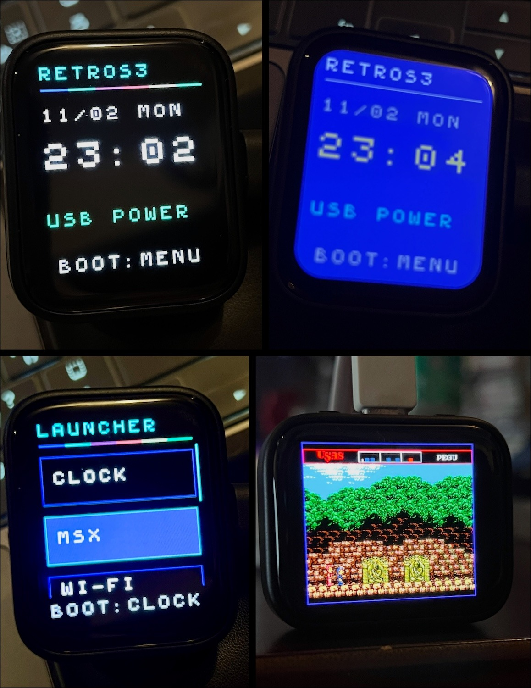

# RetroS3 Watch

RetroS3 Watchは、Waveshare ESP32-S3-Touch-AMOLED-1.8 V2で動くMSX互換時計です。
独自エミュレーター「RetroS3 MSX」でMSX1・MSX2・MSX2+に対応し、タッチランチャー、
8BitDo Micro操作、音声、ステートセーブ、Wi-Fiファイル転送を備えています。

[English README](README.md)

## 最初に読む文書

- [最新版をダウンロード](https://github.com/game-de-it/RetroS3-Watch/releases/latest)
- [導入マニュアル](docs/INSTALLATION.ja.md)
- [ユーザー向け操作マニュアル](docs/USER_GUIDE.ja.md)
- [開発者向けマニュアル](docs/DEVELOPER_GUIDE.ja.md)
- [サードパーティライセンス](THIRD_PARTY_LICENSES.md)

配布ZIPには書き込み用ファームウェアと、3機種分のC-BIOS 0.29を収録しています。
カートリッジ（`.rom`）、読み取り専用ディスク（`.dsk`）、カセット（`.cas`）は
利用者が用意します。ゲーム、正規MSX BIOS、ユーザーデータは同梱していません。

## ライセンスの要点

RetroS3 MSXを含む独自コードはMITライセンスです。C-BIOS、フォント、ESP-IDF、
LVGL、ボードサポートには、それぞれのライセンスが適用されます。
[サードパーティライセンスの詳細](THIRD_PARTY_LICENSES.md)

## 検証済み構成

- Waveshare ESP32-S3-Touch-AMOLED-1.8 V2
- ESP-IDF 5.5.5
- DIOフラッシュモード、16 MiBフラッシュ、8 MiB Octal PSRAM
- 8BitDo Micro Kモード（`80EL`）
- 起動時は100%描画。実機のUSASデモで、安定した10秒間は約59.4fpsでした。
  起動や場面切り替えでは表示頻度が下がる場合があります。
- SELECTでMSXメニュー、STARTでソフトウェアキーボードを開きます。
  長いディスク名はカーソルを合わせると横にスクロールします。

## 主な制限

- C-BIOSは主にカートリッジ向けです。テープやBASICには対応するシステムBIOSを、
  ディスクの利用にはWD2793互換のDiskROMも用意してください。
- 新しいステート（`.rss`）の復元には、保存時と同じBIOSとメディアが必要です。
  v0.1.0のステートとは互換性がありません。
- [互換性と検証の詳細](docs/INDEPENDENT_MSX.ja.md)

## 商標

RetroS3 Watchは独立したプロジェクトであり、MSX Licensing Corporation、
Microsoft、Espressif Systems、Waveshareによる公認・提携製品ではありません。
MSXはMSX Licensing Corporationの商標です。その他の名称・商標は各権利者に
帰属します。MSXロゴは同梱しません。

