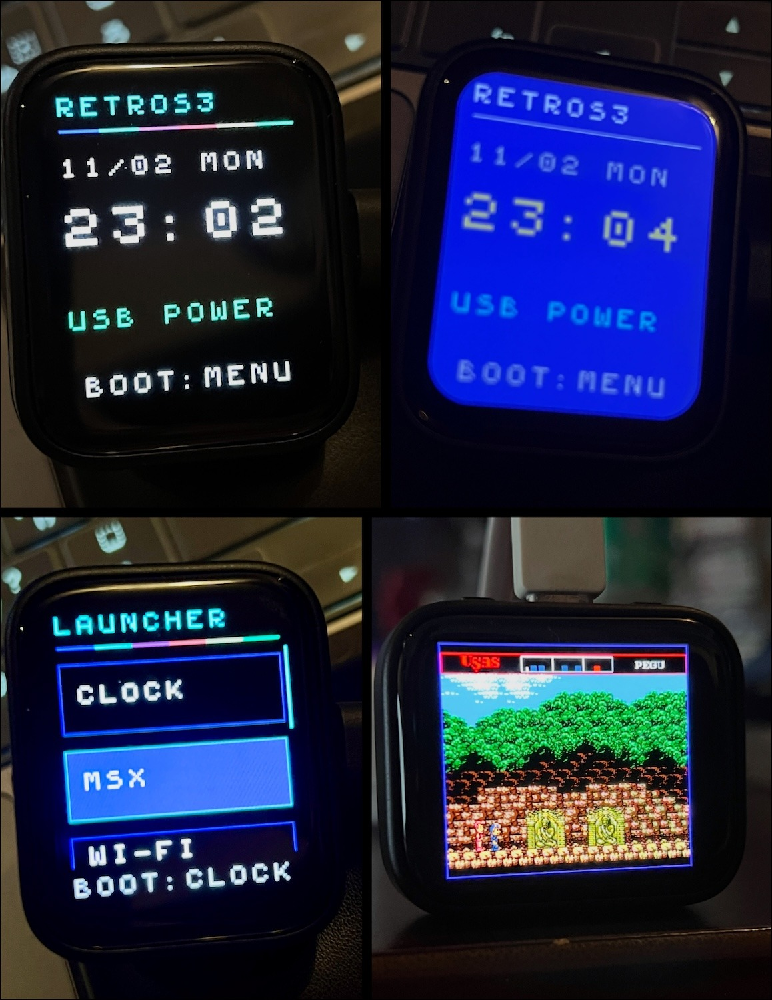

# RetroS3 Watch

RetroS3 Watch turns the Waveshare ESP32-S3-Touch-AMOLED-1.8 V2 into a compact
MSX-compatible watch. Its original RetroS3 MSX emulator supports MSX1, MSX2,
and MSX2+, with a touch launcher, 8BitDo Micro controls, sound, per-game save
states, and Wi-Fi file upload.

[Japanese README / 日本語README](README.ja.md)

## Start here

- [Download the latest release](https://github.com/game-de-it/RetroS3-Watch/releases/latest)
- [Installation guide](docs/INSTALLATION.md)
- [User guide](docs/USER_GUIDE.md)
- [Developer guide](docs/DEVELOPER_GUIDE.md)
- [Third-party licenses](THIRD_PARTY_LICENSES.md)

The release includes flashable firmware and C-BIOS 0.29 for all three machine
profiles. Supply your own cartridge images (`.rom`), read-only disk images
(`.dsk`), or cassette images (`.cas`). Games, proprietary BIOS, and user
data are excluded from the download.

## License summary

The watch firmware's original code, including the RetroS3 MSX emulator, is
MIT-licensed. C-BIOS, fonts, ESP-IDF, LVGL, and board support retain their own
licenses. [Third-party license details](THIRD_PARTY_LICENSES.md)

## Validated target

- Waveshare ESP32-S3-Touch-AMOLED-1.8 V2
- ESP-IDF 5.5.5
- DIO flash mode, 16 MiB flash, 8 MiB octal PSRAM
- 8BitDo Micro in K mode (`80EL`) is the validated controller
- Rendering is set to 100% at boot. The animated USAS demo reached about
  59.4 fps over a steady 10-second interval on the watch. Startup and scene
  transitions can run at a lower rate.
- SELECT opens the MSX menu. START opens the software keyboard. Hold the
  selection on a long disk name to scroll it.

## Important limits

- C-BIOS is intended mainly for cartridge software. Use the appropriate system
  BIOS for cassette/BASIC and a compatible WD2793 DiskROM for disk software.
- The new `.rss` save states require the same BIOS and media. States from
  v0.1.0 use an incompatible format.
- [Compatibility details and verification](docs/INDEPENDENT_MSX.md)

## Trademarks

RetroS3 Watch is an independent project and is not endorsed by or affiliated
with MSX Licensing Corporation, Microsoft, Espressif Systems or Waveshare.
MSX is a trademark of MSX Licensing Corporation. Other names and marks belong
to their respective owners. No MSX logo is included.

